


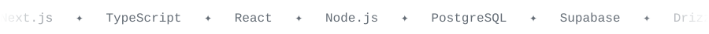


 

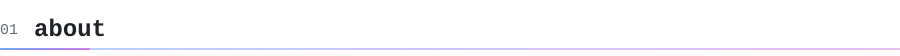

**Full Stack Developer at [Saptarishi Solutions](https://saptarishi.tech/en)**, shipping enterprise software: an ESS platform, a CRM and data-migration dashboards on Next.js, Redux and PostgreSQL.

**Founder-engineer behind [SwiftProject](https://www.swiftproject.in)**, my freelance studio: 11+ apps live in production, fixed-quote sprints, direct engineer access.

I turn complex problems into software people actually use. Typed APIs, validated input, boring-reliable databases, interfaces that stay out of the way. Based in Bangalore and Hyderabad.

 


 

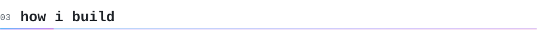

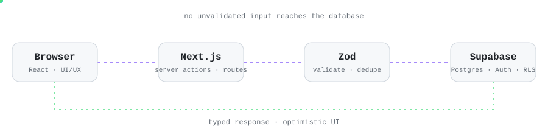

 

 

<table>
<tr>
<td width="50%"><a href="https://devforge.swiftproject.in"></a></td>
<td width="50%"><a href="https://devstation.swiftproject.in"></a></td>
</tr>
<tr>
<td width="50%"><a href="https://vault.swiftproject.in"></a></td>
<td width="50%"><a href="https://wg.swiftproject.in"></a></td>
</tr>
<tr>
<td width="50%"><a href="https://swiftconvert.vercel.app"></a></td>
<td width="50%"><a href="https://sriram.swiftproject.in"></a></td>
</tr>
<tr>
<td width="50%"><a href="https://aoldbirthdays.swiftproject.in"></a></td>
<td width="50%"><a href="https://kathakaalaamsam.vercel.app"></a></td>
</tr>
<tr>
<td width="50%"><a href="https://sripoojithadryfruits.in"></a></td>
<td width="50%"><a href="https://sharathkancherla.com"></a></td>
</tr>
<tr>
<td width="50%"><a href="https://url.swiftproject.in"></a></td>
<td width="50%"><a href="https://swiftplanner.vercel.app"></a></td>
</tr>
</table>

12 of 16 — the full archive lives at <a href="https://sriram.swiftproject.in">sriram.swiftproject.in</a>

 

**SwiftProject** is how I take on client work: one engineer, fixed scope, fixed timeline, no hourly billing.


 

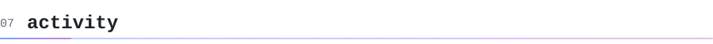


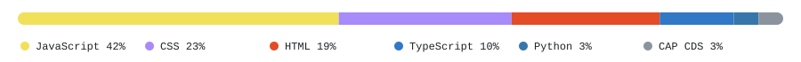

 

