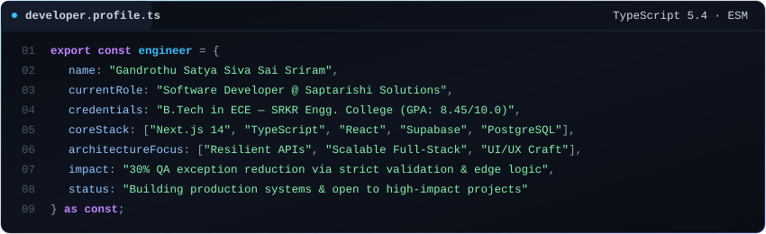

  

[portfolio](https://sriram.swiftproject.in/) &nbsp;·&nbsp;
[linkedin](https://linkedin.com/in/sriram-gandrothu-2a653b219) &nbsp;·&nbsp;
[github](https://github.com/sriramgandrothu) &nbsp;·&nbsp;
[email](mailto:sriramgandrothu@gmail.com) &nbsp;·&nbsp;
[instagram](https://instagram.com/sriramgandrothu)

 

> **Software Developer @ Saptarishi Solutions** &nbsp;·&nbsp; Full-Stack Architect &amp; UI/UX Craftsman 
> Former Engineering Intern @ Sumeru Technology &nbsp;·&nbsp; B.Tech ECE, SRKREC (GPA: 8.45 / 10.0)

I engineer resilient, scalable web applications and high-fidelity user experiences designed for peak performance. 
Currently building production-grade enterprise platforms utilizing **Next.js 14**, **TypeScript**, **Supabase**, and **PostgreSQL**. 
Focused on clean architectural patterns, robust API boundaries, and eliminating production exceptions through strict validation schemas.

 

  

**Core Languages** 
<samp>typescript &nbsp;·&nbsp; javascript &nbsp;·&nbsp; python &nbsp;·&nbsp; java &nbsp;·&nbsp; sql &nbsp;·&nbsp; c</samp>

**Frontend &amp; UI Architecture** 
<samp>next.js (app router) &nbsp;·&nbsp; react 19 &nbsp;·&nbsp; tailwindcss &nbsp;·&nbsp; vue.js &nbsp;·&nbsp; figma &nbsp;·&nbsp; responsive ui/ux &nbsp;·&nbsp; bootstrap</samp>

**Backend, Data &amp; Cloud** 
<samp>node.js &nbsp;·&nbsp; express.js &nbsp;·&nbsp; supabase v2 &nbsp;·&nbsp; postgresql &nbsp;·&nbsp; mongodb &nbsp;·&nbsp; rest apis &nbsp;·&nbsp; zod &nbsp;·&nbsp; edge functions</samp>

**Tooling &amp; Systems** 
<samp>git &nbsp;·&nbsp; docker &nbsp;·&nbsp; vs code &nbsp;·&nbsp; postman &nbsp;·&nbsp; vercel &nbsp;·&nbsp; linux &nbsp;·&nbsp; adobe xd &nbsp;·&nbsp; zeplin &nbsp;·&nbsp; power bi</samp>

  

**KathaKaalaamsam** &nbsp;·&nbsp; <samp>next.js · supabase v2 · react · tailwind · edge storage</samp> 
Full-stack podcast and multimedia platform with end-to-end CRUD capabilities, administrative role-based access control (RBAC), and dynamic content management for audio streaming, voice archives, and writings. Migrated to Supabase V2 to achieve seamless cloud scalability and sub-second asset retrieval.

**SwiftLinker** &nbsp;·&nbsp; <samp>next.js · supabase · typescript · analytics engine</samp> 
High-performance URL engine with instantaneous link redirection and real-time usage telemetry. Engineered with edge-caching logic to track visitor metrics, device distribution, and click velocity with minimal latency.

**Enterprise Event Management Engine** &nbsp;·&nbsp; <samp>next.js · zod · supabase · concurrency guard</samp> 
Production-grade event and course registration platform engineered at Sumeru Technology. Implemented dynamic cutoff logic, idempotent duplicate registration prevention, and strict validation schemas that **reduced system exceptions by 30%** during QA and load testing.

**Department Management Suite** &nbsp;·&nbsp; <samp>react · node.js · express · postgresql</samp> 
Comprehensive organizational platform handling student information architecture, staff resource allocations, real-time expense telemetry, and localized utility services.

  

**Saptarishi Solutions Pvt. Ltd.** &nbsp;·&nbsp; <samp>Software Developer</samp> 
*Bengaluru, India* 
- Leading full-stack engineering initiatives utilizing Next.js, Supabase, and TypeScript.
- Designing responsive, accessible frontend architectures and robust backend data services.
- Collaborating with cross-functional teams to translate complex requirements into resilient production code.

**Sumeru Technology Pvt. Ltd.** &nbsp;·&nbsp; <samp>Engineering Intern</samp> 
*Dec 2024 – Oct 2025 · Bengaluru, India* 
- Delivered core course &amp; event management modules using Next.js, Supabase, and Zod.
- Formulated fault-tolerant validation logic that decreased runtime QA exceptions by **30%**.
- Enforced modular software architecture, standardized error handling, and end-to-end QA coverage.

**Leadership &amp; Institutional Impact** &nbsp;·&nbsp; <samp>SRKR Engineering College</samp> 
- **Mentor**, Full Stack Development @ Vedic Vision Hackathon (coaching 50+ engineers).
- **President**, PAIE Cell &amp; **Vice President**, Student Council at SRKREC.
- **Volunteer &amp; Community Member**, Art of Living &amp; Language Nest.

  

  

  

  

| Channel | Endpoint | Protocol |
|:---|:---|:---|
| **Portfolio** | [sriram.swiftproject.in](https://sriram.swiftproject.in/) | HTTP/3 Web |
| **LinkedIn** | [/in/sriram-gandrothu](https://linkedin.com/in/sriram-gandrothu-2a653b219) | Direct Message |
| **GitHub** | [@sriramgandrothu](https://github.com/sriramgandrothu) | Repositories &amp; Stars |
| **Email** | [sriramgandrothu@gmail.com](mailto:sriramgandrothu@gmail.com) | Priority Inquiries |
| **Direct Phone** | `+91 7842713943` | Voice &amp; WhatsApp |

 

<samp>“First solve the problem. Then, write the code.”</samp>

  

<samp>Engineered with craft by <strong>Sriram Gandrothu</strong> · Zero external bloat · Self-contained vector telemetry</samp>

